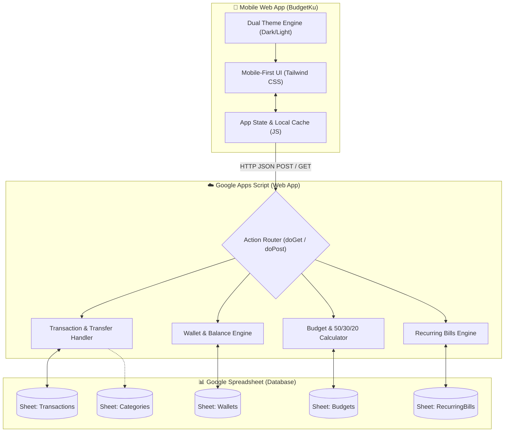
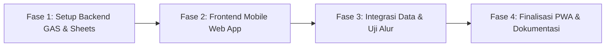

# Product Requirements Document (PRD)
## Aplikasi Web Mobile: BudgetKu

---

## 1. Ringkasan Eksekutif & Visi Produk
**BudgetKu** adalah aplikasi pencatat dan pengendali keuangan pribadi berbasis web (*mobile-first web app / PWA*) yang dirancang khusus untuk kenyamanan penggunaan satu tangan pada smartphone. Aplikasi ini menggunakan **Google Sheets** sebagai basis data gratis, transparan, dan fleksibel, yang dihubungkan melalui API **Google Apps Script (GAS)**.

Berdasarkan 10 preferensi pengguna yang telah diselaraskan, BudgetKu berfokus pada:
- **Kecepatan Input Transaksi**: Memangkas waktu pencatatan di bawah 5 detik per transaksi.
- **Transparansi Multi-Dompet**: Memisahkan dan melacak saldo uang tunai, bank, serta e-wallet secara akurat termasuk fitur transfer antar dompet.
- **Pengendalian Anggaran Cerdas**: Mendukung batas pengeluaran **Mingguan** & **Bulanan**, serta evaluasi makro berbasis **Metode 50/30/20** (*Needs / Wants / Savings*).
- **Manajemen Tagihan Rutin**: Daftar tagihan berkala (WiFi, kos, langganan streaming) dengan tanggal jatuh tempo dan tombol bayar cepat.
- **Kenyamanan Visual & Privasi**: Fitur sensor saldo (ikon mata) dan dukungan **Dual Theme** (*Modern Dark Mode* & *Clean Minimalist Light Mode*).

---

## 2. Sasaran Pengguna & Kebutuhan Utama
- **Target Pengguna**: Individu yang ingin mencatat keuangan harian dengan cepat dan tanpa ribet.
- **Kesiapan Masa Depan**: Disiapkan dengan kolom identitas pencatat (`user_id` / `recorded_by`) agar dapat berkembang menjadi aplikasi bersama (pasangan/keluarga) di fase berikutnya tanpa merombak struktur data.
- **Lingkup Keuangan**: 100% Keuangan Pribadi yang bersih dan terfokus.
- **Konektivitas**: Online-first ke Google Apps Script, dengan penyimpanan sementara di `localStorage` sebagai fondasi mode *offline* di masa depan.

---

## 3. Arsitektur Sistem

---

## 4. Desain Struktur Database (Google Sheets)

Satu file Google Spreadsheet terdiri dari 5 sheet terstruktur:

### Sheet 1: `Transactions`
Menyimpan riwayat mutasi keuangan (Pemasukan, Pengeluaran, dan Pindah Saldo).
| Kolom | Nama Field | Tipe Data | Deskripsi / Contoh |
| :--- | :--- | :--- | :--- |
| A | `id` | String | ID unik (contoh: `TX-20261018-001`) |
| B | `date` | Date (YYYY-MM-DD) | Tanggal transaksi (`2026-10-18`) |
| C | `type` | Enum | `Expense` \| `Income` \| `Transfer` |
| D | `amount` | Number | Nominal mutasi (contoh: `45000`) |
| E | `category` | String | Nama kategori (contoh: `Makan & Minum`) |
| F | `macro_type` | Enum | `Needs (50%)` \| `Wants (30%)` \| `Savings (20%)` \| `None` |
| G | `wallet_from` | String | Dompet asal sumber dana (contoh: `BCA`) |
| H | `wallet_to` | String | Dompet tujuan (khusus `Transfer`, contoh: `GoPay`) |
| I | `notes` | String | Catatan keterangan transaksi |
| J | `user_id` | String | Default `user_primary` (persiapan multi-user) |
| K | `created_at` | Timestamp | Waktu input sistem |

### Sheet 2: `Wallets`
Menyimpan daftar akun/dompet dan saldo awal.
| Kolom | Nama Field | Tipe Data | Contoh Data |
| :--- | :--- | :--- | :--- |
| A | `wallet_id` | String | `W-01`, `W-02`, dst. |
| B | `wallet_name` | String | `Tunai`, `BCA`, `GoPay`, `ShopeePay` |
| C | `initial_balance` | Number | `500000` |
| D | `icon` | String (Emoji) | 💵 / 🏦 / 📱 |
| E | `color` | String (Hex/Badge) | `#3B82F6` |

### Sheet 3: `Categories`
Daftar kategori transaksi beserta alokasi 50/30/20.
| Kolom | Nama Field | Tipe Data | Contoh Data |
| :--- | :--- | :--- | :--- |
| A | `category_id` | String | `CAT-01` |
| B | `category_name` | String | `Makan & Minum`, `Transportasi`, `Gaji` |
| C | `type` | Enum | `Expense` \| `Income` |
| D | `macro_group` | Enum | `Needs`, `Wants`, `Savings` |
| E | `icon` | String (Emoji) | 🍔, 🛵, 💰 |

### Sheet 4: `Budgets`
Target batas pengeluaran kategori.
| Kolom | Nama Field | Tipe Data | Contoh Data |
| :--- | :--- | :--- | :--- |
| A | `category_name` | String | `Makan & Minum` |
| B | `monthly_limit` | Number | `1500000` |
| C | `weekly_limit` | Number | `375000` |
| D | `period` | String (YYYY-MM) | `2026-10` |

### Sheet 5: `RecurringBills`
Daftar tagihan atau pengeluaran langganan rutin bulanan.
| Kolom | Nama Field | Tipe Data | Contoh Data |
| :--- | :--- | :--- | :--- |
| A | `bill_id` | String | `BILL-01` |
| B | `bill_name` | String | `WiFi Indihome`, `Kos Bulanan`, `Netflix` |
| C | `amount` | Number | `350000` |
| D | `due_day` | Number (1-31) | `10` (Jatuh tempo setiap tgl 10) |
| E | `category` | String | `Tagihan & Utilitas` |
| F | `wallet_default` | String | `BCA` |
| G | `is_active` | Boolean | `TRUE` |

---

## 5. Kebutuhan Fungsional (Feature Specifications)

### 5.1 Dashboard Utama (Home)
- **Net Balance Display**: Menampilkan total saldo bersih seluruh dompet.
- **Privacy Toggle (Sensor Mata)**: Ikon mata untuk menyembunyikan/blur angka saldo menjadi `Rp ••••••`.
- **Theme Switcher**: Tombol cepat untuk beralih antara Mode Gelap (*Modern Dark*) dan Mode Terang (*Clean Minimalist*).
- **Rincian Saldo Dompet**: Carousel kartu mini tiap dompet beserta tombol cepat "Transfer Saldo".
- **Widget Alokasi 50/30/20**: Progress bar interaktif pembagian pengeluaran bulanan (Kebutuhan vs Keinginan vs Tabungan).
- **Weekly Budget Spotlight**: Indikator sisa jatah anggaran minggu berjalan (Hijau = aman, Kuning = >80%, Merah = over-budget).
- **Pengingat Tagihan Terdekat**: Kartu notifikasi tagihan yang jatuh tempo dalam waktu dekat.
- **Riwayat Singkat**: Daftar 5 transaksi terakhir dengan status dan ikon kategori.

### 5.2 Modal Input Cepat (Quick Add)
- Tombol mengambang (*Floating Action Button*) `+` di tengah bottom navigation bar.
- Tab pilihan jenis transaksi: **Pengeluaran** | **Pemasukan** | **Transfer Antar Dompet**.
- Form nominal ramah satu tangan dilengkapi tombol cepat (*Quick Chips*): `+10rb`, `+20rb`, `+50rb`, `+100rb`, dan `Reset`.
- Pilihan Dompet dan Kategori berbasis *Grid Icon* yang mudah di-tap.
- Otomatis mengisi tanggal hari ini dan klasifikasi 50/30/20 secara pintar.

### 5.3 Riwayat & Filter Transaksi
- Filter transaksi berdasarkan bulan/tahun, dompet, dan kategori.
- Kolom pencarian catatan transaksi.
- Kemampuan untuk **Edit** dan **Hapus** transaksi (otomatis merevisi saldo di Google Sheets).

### 5.4 Anggaran & Analisis (Budgeting & Analytics)
- Visualisasi diagram lingkaran (*Donut Chart*) pengeluaran per kategori.
- Progres bar anggaran bulanan dan mingguan untuk masing-masing kategori pengeluaran.
- Analisis kesesuaian gaya hidup dengan rasio ideal 50/30/20.

### 5.5 Manajemen Tagihan Rutin (Bills)
- Daftar pengeluaran langganan bulanan dengan tanggal jatuh tempo.
- Tombol satu-klik *"Bayar / Tandai Lunas"* yang langsung membuat catatan transaksi pengeluaran otomatis.

---

## 6. Spesifikasi Antarmuka & UX Mobile
1. **Mobile-First Layout**:
   - Dioptimalkan untuk layar ponsel (lebar 360px - 430px) dan terpusat rapi saat dibuka di layar komputer/desktop (`max-width: 480px`).
   - Ukuran elemen sentuh (*touch target*) minimal 44px agar ramah jempol.
2. **Fixed Bottom Navigation**:
   - 🏠 **Home**: Dashboard, Saldo, Ringkasan Budget & Tagihan.
   - 📑 **Riwayat**: List mutasi transaksi & filter.
   - ➕ **Tambah (Tengah)**: Membuka modal input cepat.
   - 📊 **Anggaran & Analisis**: Grafik 50/30/20 & budget mingguan/bulanan.
   - ⚙️ **Pengaturan**: Konfigurasi dompet, kategori, tagihan, dan URL API.
3. **Dual Theme Design System**:
   - **Modern Dark Mode**: Latar `#0F172A` (Slate 900), kartu `#1E293B`, teks `#F8FAFC`. Elegan dan ramah baterai OLED.
   - **Clean Light Mode**: Latar `#F8FAFC` (Off-white), kartu `#FFFFFF`, border halus `#E2E8F0`, teks `#0F172A`. Minimalis ala Notion/Apple.

---

## 7. Desain API Google Apps Script (`Code.gs`)
Apps Script bertindak sebagai backend RESTful tanpa server (*serverless*) dengan respon format JSON:

### Endpoint `doGet(e)`
- `?action=getInitData`: Mengambil data awal dompet, kategori, tagihan, dan budget.
- `?action=getDashboard&month=YYYY-MM`: Mengambil agregasi saldo, ringkasan pengeluaran/pemasukan, data 50/30/20, dan riwayat transaksi terbaru.
- `?action=getTransactions&month=YYYY-MM`: Mengambil mutasi bulan berjalan.

### Endpoint `doPost(e)`
- `{ action: "addTransaction", data: {...} }`: Menyimpan transaksi pengeluaran/pemasukan baru.
- `{ action: "transferFunds", data: { from, to, amount, date, notes } }`: Mencatat mutasi transfer antar dompet.
- `{ action: "deleteTransaction", id: "TX-..." }`: Menghapus baris transaksi.
- `{ action: "editTransaction", id: "TX-...", data: {...} }`: Mengubah detail transaksi.
- `{ action: "payRecurringBill", billId: "...", date: "...", wallet: "..." }`: Otomatis membukukan pembayaran tagihan rutin.

---

## 8. Rencana Implementasi & Roadmap Pengembangan

1. **Fase 1: Backend Google Apps Script (`Code.gs`)**:
   - Menulis skrip GAS lengkap dengan fungsi otomatisasi pembuatan lembar sheet (`setupSheet()`).
   - Menerapkan fungsi router `doGet` dan `doPost`.
2. **Fase 2: Frontend Web App (`index.html`)**:
   - Membangun antarmuka mobile responsif dengan Tailwind CSS.
   - Mengimplementasikan Dual Theme (Dark/Light switch).
   - Membangun modal input cepat dengan Numpad & Quick Chips (+10rb s/d +100rb).
   - Memasang fitur sensor privasi saldo.
3. **Fase 3: Integrasi & Fungsionalitas**:
   - Menghubungkan antarmuka ke endpoint Google Apps Script.
   - Menghitung logika anggaran mingguan & bulanan serta rasio 50/30/20.
   - Pengujian aliran mutasi dan transfer saldo antar dompet.
4. **Fase 4: Konfigurasi PWA & Panduan Deploy**:
   - Membuat file `manifest.json` agar aplikasi dapat dipasang (*Add to Home Screen*) di ponsel.
   - Menyiapkan panduan langkah demi langkah cara menempelkan skrip ke Google Sheets dan menjalankan webnya.
